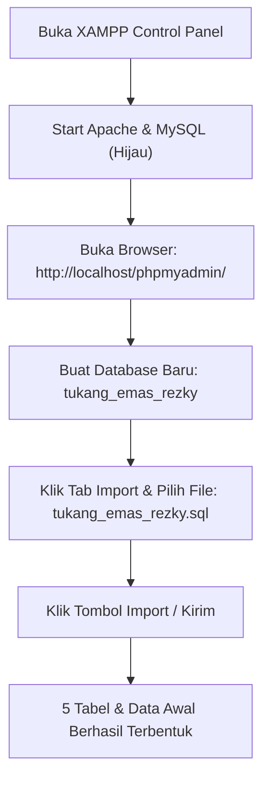

# Buku Panduan Penggunaan (Manual Book)
# Website TUKANG EMAS REZKY

Panduan resmi instalasi, konfigurasi database, dan pengoperasian sistem website **TUKANG EMAS REZKY**.  
Panduan ini dimulai dari langkah paling awal: **menyiapkan dan meng-import database SQL**, dilanjutkan dengan konfigurasi sistem, panduan pengunjung, hingga panduan pengelolaan panel admin.

---

## 1. Langkah Awal: Menyiapkan & Meng-Import Database SQL



### 1.1 Menjalankan XAMPP (Apache & MySQL)
1. Buka aplikasi **XAMPP Control Panel** di komputer/laptop Anda.
2. Cari baris **Apache**, lalu klik tombol **Start** di sebelah kanannya (indikator akan berubah warna menjadi hijau).
3. Cari baris **MySQL**, lalu klik tombol **Start** di sebelah kanannya (indikator akan berubah warna menjadi hijau dengan port default `3306`).

> [!IMPORTANT]
> Kedua modul (Apache dan MySQL) wajib berstatus **Running** (hijau) agar website dan database dapat berkomunikasi dengan lancar.

---

### 1.2 Membuka phpMyAdmin
1. Buka web browser (Google Chrome, Microsoft Edge, Mozilla Firefox, dll).
2. Ketik alamat berikut pada address bar browser Anda lalu tekan Enter:
   ```text
   http://localhost/phpmyadmin/
   ```
3. Anda akan masuk ke halaman antarmuka pengelolaan database phpMyAdmin.

---

### 1.3 Membuat Database Baru
1. Pada panel sebelah kiri phpMyAdmin, klik menu **New** (atau **Baru**).
2. Pada kolom **Database name** (Nama basis data), ketik tepat:
   ```text
   tukang_emas_rezky
   ```
3. Pada pilihan Collation di sebelahnya, pilih **`utf8mb4_general_ci`** (atau biarkan default).
4. Klik tombol **Create** (atau **Buat**).
5. Database `tukang_emas_rezky` kini telah berhasil dibuat dan akan muncul di daftar database sebelah kiri.

---

### 1.4 Meng-Import File `tukang_emas_rezky.sql`
File database SQL proyek telah tersedia di dalam folder utama website dengan nama:  
[tukang_emas_rezky.sql](file:///e:/xampp/htdocs/TUKANG-EMAS-REZKY/tukang_emas_rezky.sql)

Berikut langkah-langkah meng-import file tersebut:
1. Klik nama database **`tukang_emas_rezky`** pada daftar sebelah kiri phpMyAdmin untuk memastikannya terpilih.
2. Pada deretan tab menu di bagian atas, klik tab **Import**.
3. Pada bagian *File to import* (Berkas untuk diimpor), klik tombol **Choose File** (atau **Pilih Berkas**).
4. Arahkan ke folder proyek Anda:  
   `E:\xampp\htdocs\TUKANG-EMAS-REZKY\`  
   lalu pilih file bernama **`tukang_emas_rezky.sql`**, kemudian klik **Open**.
5. Gulir ke bagian paling bawah halaman phpMyAdmin, lalu klik tombol **Import** (atau tombol **Kirim / Go**).
6. Tunggu beberapa detik hingga proses selesai.  
   Jika berhasil, akan muncul pesan berwarna hijau:  
   *`Import has been successfully finished, queries executed.`*

#### Struktur 5 Tabel yang Terbentuk Secara Otomatis:
* **`admin`**: Menyimpan akun pengelola (username dan password terenkripsi).
* **`koleksi`**: Menyimpan data katalog perhiasan (nama, kategori, deskripsi, gambar, tanggal). Otomatis terisi 19 produk perhiasan bawaan.
* **`galeri`**: Menyimpan foto-foto dokumentasi hasil karya.
* **`harga_emas`**: Menyimpan cache harga pasar emas harian (kadar 88% dan 90%).
* **`pesanan`**: Menyimpan data transaksi pesanan custom dari pelanggan.

---

### 1.5 Memeriksa File Konfigurasi Koneksi (`config/db.php`)
Konfigurasi database proyek telah diatur pada file [config/db.php](file:///e:/xampp/htdocs/TUKANG-EMAS-REZKY/config/db.php):
```php
$host = "localhost";
$user = "root";
$pass = "";
$db   = "tukang_emas_rezky";
```
* Jika instalasi XAMPP Anda menggunakan pengaturan bawaan (user `root` tanpa password), Anda **tidak perlu mengubah apapun**.
* File ini telah dilengkapi proteksi `mysqli_report(MYSQLI_REPORT_OFF)` untuk menjamin kredensial tidak pernah bocor ke publik.

---

### 1.6 Akun Login Admin Bawaan
Database yang telah Anda import sudah berisi akun administrator awal:
* **Halaman Login**: [admin/login.php](file:///e:/xampp/htdocs/TUKANG-EMAS-REZKY/admin/login.php)
* **Username**: `admin`
* **Password**: `admin`

---

## 2. Alamat URL & Struktur Halaman Website

### Halaman Pengunjung (Publik):
* **Beranda (Home)**: [http://localhost/TUKANG-EMAS-REZKY/](http://localhost/TUKANG-EMAS-REZKY/)
* **Tentang Kami**: [http://localhost/TUKANG-EMAS-REZKY/tentang.html](http://localhost/TUKANG-EMAS-REZKY/tentang.html)
* **Koleksi Perhiasan**: [http://localhost/TUKANG-EMAS-REZKY/koleksi.html](http://localhost/TUKANG-EMAS-REZKY/koleksi.html)
* **Galeri Dokumentasi**: [http://localhost/TUKANG-EMAS-REZKY/galeri.html](http://localhost/TUKANG-EMAS-REZKY/galeri.html)
* **Kalkulator Estimasi Custom**: [http://localhost/TUKANG-EMAS-REZKY/estimasi.html](http://localhost/TUKANG-EMAS-REZKY/estimasi.html)
* **Kontak**: [http://localhost/TUKANG-EMAS-REZKY/kontak.html](http://localhost/TUKANG-EMAS-REZKY/kontak.html)

### Panel Pengelolaan (Administrator):
* **Login Admin**: [http://localhost/TUKANG-EMAS-REZKY/admin/login.php](http://localhost/TUKANG-EMAS-REZKY/admin/login.php)
* **Dashboard Admin**: [http://localhost/TUKANG-EMAS-REZKY/admin/index.php](http://localhost/TUKANG-EMAS-REZKY/admin/index.php)
* **Kelola Pesanan**: [http://localhost/TUKANG-EMAS-REZKY/admin/pesanan.php](http://localhost/TUKANG-EMAS-REZKY/admin/pesanan.php)
* **Kelola Koleksi**: [http://localhost/TUKANG-EMAS-REZKY/admin/koleksi.php](http://localhost/TUKANG-EMAS-REZKY/admin/koleksi.php)
* **Kelola Galeri**: [http://localhost/TUKANG-EMAS-REZKY/admin/galeri.php](http://localhost/TUKANG-EMAS-REZKY/admin/galeri.php)

---

## 3. Panduan Halaman Pengunjung (Pelanggan)

### 3.1 Beranda (`index.html`)
Menampilkan identitas usaha, layanan pembuatan emas custom 22 karat, produk unggulan, dan akses langsung ke konsultasi WhatsApp.

### 3.2 Tentang Kami & Video Workshop (`tentang.html`)
* Profil dedikasi pengrajin emas dalam menjaga ketepatan kadar dan kerapian detail.
* **Video Dokumentasi Workshop**: Dilengkapi kontrol pemutar video (*play, pause, volume, fullscreen*) yang menampilkan proses pembuatan perhiasan di bengkel kerja TUKANG EMAS REZKY.

### 3.3 Katalog Koleksi Perhiasan (`koleksi.html`)
* **Pencarian Cepat (*Live Search*)**: Cari nama cincin, gelang, kalung secara instan tanpa reload halaman.
* **Filter Kategori**: Filter kategori dengan tombol tab **Semua**, **Cincin**, **Anting**, **Kalung**, **Gelang**, **Liontin**.
* **Modal Detail Produk**: Klik tombol *Lihat Detail* pada kartu produk untuk melihat foto beresolusi penuh dan deskripsi.
* **Tombol Pesan Custom**: Di dalam modal detail terdapat tombol langsung untuk memesan model perhiasan serupa.

### 3.4 Galeri Dokumentasi Foto (`galeri.html`)
Menampilkan foto-foto dokumentasi hasil karya perhiasan yang telah selesai dibuat. Disinkronkan langsung dari database admin.

### 3.5 Kalkulator Estimasi Custom & WhatsApp (`estimasi.html`)
1. **Nama Pelanggan**: Masukkan nama lengkap.
2. **Jenis Perhiasan**: Pilih Cincin, Anting, Kalung, Gelang, atau Liontin.
3. **Ukuran**: Masukkan ukuran (contoh: `17`, `Dewasa`).
4. **Kadar Emas 22 Karat**: Pilih kadar **88%** atau **90%**.
   > [!NOTE]
   > Harga emas per gram otomatis terisi dari database/API pasar terkini dan bersifat *read-only*.
5. **Berat Perhiasan**: Masukkan perkiraan berat dalam gram (contoh: `5.2`).
6. **Desain / Referensi**: Jelaskan detail model yang diinginkan.
7. **Ukiran**: Tulis ukiran grafir (contoh: `B & S 2026`). Simbol khusus seperti `&` aman dan tidak akan terpotong.
8. **Catatan**: Instruksi tambahan (opsional).
9. **Hitung Estimasi**: Klik tombol *Hitung Estimasi* untuk mengetahui perkiraan biaya (`Berat × Harga Emas`).
10. **Kirim ke WhatsApp**: Klik tombol *Kirim ke WhatsApp*.
    - Rincian pesanan otomatis tersimpan ke database admin dengan status *"Menunggu"*.
    - Browser otomatis membuka chat WhatsApp resmi TUKANG EMAS REZKY (`+62 853-4362-6789`) dengan format pesan yang sudah terisi rapi.

---

## 4. Panduan Administrator (Panel Admin)

### 4.1 Login Admin & Keamanan Sesi (`admin/login.php`)
* Buka [admin/login.php](file:///e:/xampp/htdocs/TUKANG-EMAS-REZKY/admin/login.php).
* Masukkan username dan password admin.
* Halaman admin dilindungi *Session Authentication Guard*. Percobaan akses langsung tanpa login otomatis dialihkan ke halaman login.

### 4.2 Dashboard Administrator (`admin/index.php`)
* **Kartu Ringkasan**: Jumlah total pesanan dan pesanan yang masih berstatus menunggu konfirmasi.
* **Informasi Harga Emas 22K Hari Ini**: Harga pasar kadar 88% dan 90% hasil pembaruan otomatis API harian.
* **Tabel Pesanan Terbaru**: Menampilkan 5 transaksi custom paling akhir untuk respon cepat.

### 4.3 Kelola Pesanan Pelanggan (`admin/pesanan.php`)
1. **4 Kartu Ringkasan Real-Time**: Memantau angka *Total Pesanan*, *Menunggu*, *Diproses*, dan *Selesai*.
2. **Live Search**: Cari data pesanan berdasarkan nama pelanggan atau perhiasan secara langsung.
3. **Tab Filter Status**: Filter sekali klik untuk menampilkan pesanan *Semua*, *Menunggu*, *Diproses*, atau *Selesai*.
4. **Badge Status Visual Berwarna**: Kuning (Menunggu), Biru (Diproses), Hijau (Selesai).
5. **Aksi Pesanan**:
   - **Detail ([pesanan-detail.php](file:///e:/xampp/htdocs/TUKANG-EMAS-REZKY/admin/pesanan-detail.php))**: Membaca spesifikasi lengkap, catatan, ukiran, dan waktu pesanan.
   - **Edit ([pesanan-edit.php](file:///e:/xampp/htdocs/TUKANG-EMAS-REZKY/admin/pesanan-edit.php))**: Mengubah status pengerjaan, mengoreksi berat gram hasil timbangan asli, atau harga deal.
   - **Hapus ([pesanan-hapus.php](file:///e:/xampp/htdocs/TUKANG-EMAS-REZKY/admin/pesanan-hapus.php))**: Menghapus data pesanan dengan dialog konfirmasi.
   - **Tambah Manual ([pesanan-tambah.php](file:///e:/xampp/htdocs/TUKANG-EMAS-REZKY/admin/pesanan-tambah.php))**: Input transaksi pesanan dari pelanggan yang datang langsung ke toko fisik.

### 4.4 Kelola Katalog Koleksi (`admin/koleksi.php`)
* Tampilan kartu responsif Bootstrap Grid dengan tinggi seragam (*equal height*).
* **Tambah Koleksi ([koleksi-tambah.php](file:///e:/xampp/htdocs/TUKANG-EMAS-REZKY/admin/koleksi-tambah.php))**: Input nama, kategori, deskripsi, dan upload foto (JPG, PNG, WEBP maks 5 MB) dengan pratinjau langsung.
* **Edit Koleksi ([koleksi-edit.php](file:///e:/xampp/htdocs/TUKANG-EMAS-REZKY/admin/koleksi-edit.php))**: Perbarui informasi atau ganti foto perhiasan.
* **Hapus Koleksi ([koleksi-hapus.php](file:///e:/xampp/htdocs/TUKANG-EMAS-REZKY/admin/koleksi-hapus.php))**: Menghapus data dari database dengan perlindungan aset gambar bersama.

### 4.5 Kelola Galeri Foto (`admin/galeri.php`)
* **Tambah Galeri ([galeri-tambah.php](file:///e:/xampp/htdocs/TUKANG-EMAS-REZKY/admin/galeri-tambah.php))**: Admin **hanya perlu memilih foto** (tidak wajib mengisi judul atau deskripsi) dan menekan tombol unggah.
* **Edit Galeri ([galeri-edit.php](file:///e:/xampp/htdocs/TUKANG-EMAS-REZKY/admin/galeri-edit.php))**: Mengganti foto dengan foto baru.
* **Hapus Galeri ([galeri-hapus.php](file:///e:/xampp/htdocs/TUKANG-EMAS-REZKY/admin/galeri-hapus.php))**: Menghapus foto dengan perlindungan file berawalan `galeri_`.

### 4.6 Konfirmasi Logout Aman
> [!TIP]
> Saat menu **Logout** diklik pada navbar admin, sistem akan menampilkan jendela dialog konfirmasi (*popup modal*):
> * Klik **Batal** jika Anda tidak sengaja menekan tombol.
> * Klik **Ya, Logout** untuk mengakhiri sesi admin secara aman.

---

## 5. Logika Bisnis & Perhitungan Harga Emas

$$\text{Harga 88\%} = \text{Harga 24K Dunia} \times 0.88$$
$$\text{Harga 90\%} = \text{Harga 24K Dunia} \times 0.90$$
$$\text{Estimasi Biaya} = \text{Berat Perhiasan (gram)} \times \text{Harga Emas Kadar Terpilih (per gram)}$$

* **Sumber API**: `https://api.goldprice.dev/v1/carat?currency=IDR`
* **Mekanisme Cache**: Harga disimpan di tabel `harga_emas` dengan penanda tanggal unik (`YYYY-MM-DD`). Selama tanggal yang sama, sistem mengambil harga dari database lokal (sangat cepat dan hemat kuota).
* **Objektivitas**: Admin tidak dapat mengubah harga secara manual untuk menjamin transparansi harga pasar.

---

## 6. Pemeliharaan Sistem & Troubleshooting (FAQ)

> [!CAUTION]
> **Cadangan Database Rutin (Backup)**:
> 1. Buka [http://localhost/phpmyadmin/](http://localhost/phpmyadmin/).
> 2. Klik database `tukang_emas_rezky`.
> 3. Klik tab **Export** di menu atas.
> 4. Pilih metode **Quick**, format **SQL**, lalu klik tombol **Export**. File backup `.sql` akan tersimpan di komputer Anda.

* **Q: Muncul pesan error koneksi database ("Gagal terhubung ke database")?**  
  *A: Pastikan Apache dan MySQL di XAMPP Control Panel sudah dalam keadaan aktif (berwarna hijau).*
* **Q: Mengapa tabel pesanan atau koleksi masih kosong saat baru di-setup?**  
  *A: Pastikan Anda sudah meng-import file `tukang_emas_rezky.sql` ke dalam phpMyAdmin sesuai panduan di **Bab 1**.*
* **Q: Apakah karakter `&` pada ukiran nama aman di WhatsApp?**  
  *A: Ya. Sistem menggunakan `encodeURIComponent()`. Tanda `&` otomatis diubah menjadi `%26` sehingga tampil sempurna di chat WhatsApp tanpa terpotong.*
